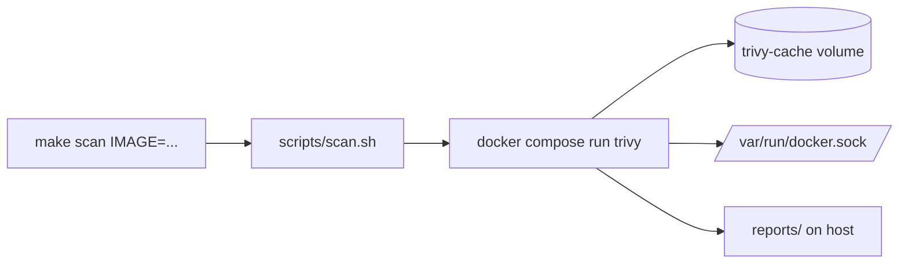

# Trivy Docker Image Scanner

[](https://github.com/<your-user>/trivy-docker-scanner/actions/workflows/ci.yml)
[](LICENSE)

A simple and practical personal repository for scanning Docker images using **Aqua Security Trivy** via Docker Compose.

No need to install Trivy locally — everything runs through Docker.

---

## Features

- Scan any Docker image (local or remote)
- Support for multiple output formats (`table`, `json`, `sarif`, etc.)
- Severity filtering
- Ignore unfixed vulnerabilities
- Exit code control (useful for CI)
- Persistent cache for faster scans
- Clean reports stored in `./reports/`

---

## Project Structure

```text
trivy-docker-scanner/
├── docker-compose.yml
├── Makefile
├── .env.example              # Registry credentials / Trivy version template
├── scripts/
│   └── scan.sh
├── reports/                  # Generated reports (gitignored)
├── examples/
│   └── Dockerfile
├── .github/workflows/ci.yml
├── CONTRIBUTING.md
└── LICENSE
```

### How it works



---

## Prerequisites

- Docker
- Docker Compose v2 (`docker compose`, not `docker-compose`)
- Linux, macOS, or Windows via WSL2 (the script is bash)
- `make` (optional; you can call `scripts/scan.sh` directly)

---

## Quick Start

```bash
# Clone the repository
git clone <your-repo-url>
cd trivy-docker-scanner

# Make the script executable (only needed once)
chmod +x scripts/scan.sh

# Run a basic scan
make scan IMAGE=nginx:latest
```

---

## Usage (Recommended: Makefile)

| Command                            | Description                            |
| ---------------------------------- | -------------------------------------- |
| `make` / `make help`               | Show help                              |
| `make scan IMAGE=<image>`          | Basic table scan                       |
| `make scan-critical IMAGE=<image>` | Fail on HIGH/CRITICAL + ignore unfixed |
| `make scan-json IMAGE=<image>`     | Generate JSON report                   |
| `make scan-sarif IMAGE=<image>`    | Generate SARIF report                  |
| `make clean`                       | Delete all reports                     |
| `make cache-clear`                 | Clear Trivy cache volume               |

`IMAGE` is required for all scan targets.

### Examples

```bash
# Basic scan
make scan IMAGE=nginx:1.25

# Strict scan (recommended for CI)
make scan-critical IMAGE=myapp:1.0.0

# Generate JSON report
make scan-json IMAGE=alpine:3.19

# Generate SARIF report
make scan-sarif IMAGE=nginx:latest

# Clean reports
make clean

# Clear cache
make cache-clear
```

---

## Advanced Usage (Direct Script)

If you need more control, you can still use the script directly:

```bash
./scripts/scan.sh [OPTIONS] <image>
```

### Available Options

| Option                 | Description                                 | Default                            |
| ---------------------- | ------------------------------------------- | ---------------------------------- |
| `-s, --severity`       | Severity levels                             | `UNKNOWN,LOW,MEDIUM,HIGH,CRITICAL` |
| `-f, --format`         | Output format (`table`, `json`, `sarif`...) | `table`                            |
| `-o, --output`         | Output filename                             | Auto-generated                     |
| `-e, --exit-code`      | Exit code when vulnerabilities found        | `0`                                |
| `-i, --ignore-unfixed` | Show only fixed vulnerabilities             | Disabled                           |
| `-c, --scanners`       | Scanners (`vuln,secret,misconfig,license`)  | `vuln,secret`                      |
| `-q, --quiet`          | Suppress logs                               | Disabled                           |
| `--no-cache`           | Disable cache                               | Disabled                           |
| `--offline`            | Offline mode                                | Disabled                           |
| `--timeout`            | Scan timeout                                | `5m0s`                             |

### Examples (using script)

```bash
./scripts/scan.sh -s HIGH,CRITICAL -e 1 myapp:latest
./scripts/scan.sh -i -f json -o report.json alpine:3.19
./scripts/scan.sh -f sarif -o results.sarif --ignore-unfixed nginx:1.25
```

---

## Using Docker Compose Directly

```bash
# Basic scan
docker compose run --rm trivy image nginx:latest

# With options
docker compose run --rm trivy image \
  --severity HIGH,CRITICAL \
  --ignore-unfixed \
  --exit-code 1 \
  --format json \
  --output /reports/report.json \
  myapp:latest
```

---

## Scanning Private Images

Using a `.env` file (recommended):

```bash
cp .env.example .env
# edit .env and set TRIVY_USERNAME / TRIVY_PASSWORD
set -a; source .env; set +a
make scan IMAGE=ghcr.io/your-org/private-image:tag
```

Or inline:

```bash
TRIVY_USERNAME=your-username TRIVY_PASSWORD=your-token \
  make scan IMAGE=ghcr.io/your-org/private-image:tag
```

Or:

```bash
docker compose run --rm \
  -e TRIVY_USERNAME=your-username \
  -e TRIVY_PASSWORD=your-token \
  trivy image ghcr.io/your-org/private-image:tag
```

---

## Reports

All reports are saved in the `./reports/` directory.

Example files:

- `trivy-nginx_latest-20261104-181500.txt`
- `trivy-report.json`
- `trivy-report.sarif`

---

## Try the example

```bash
docker build -t trivy-example examples
make scan IMAGE=trivy-example
```

---

## Notes

- The first scan may take longer because Trivy downloads the vulnerability database.
- Subsequent scans are much faster thanks to the persistent cache volume.
- The Docker socket is mounted so Trivy can access local images.
- The Trivy version is pinned in `docker-compose.yml`. Override it with `TRIVY_VERSION=<version>`.
- Reports written by the container may be root-owned; `make clean` handles that.

## Security

Mounting `/var/run/docker.sock` gives the Trivy container control over the host's Docker daemon (the `:ro` flag does not prevent that). Only run Trivy images you trust, and keep the pinned version up to date.

---

## Contributing

See [CONTRIBUTING.md](CONTRIBUTING.md).

---

## License

[MIT](LICENSE)
